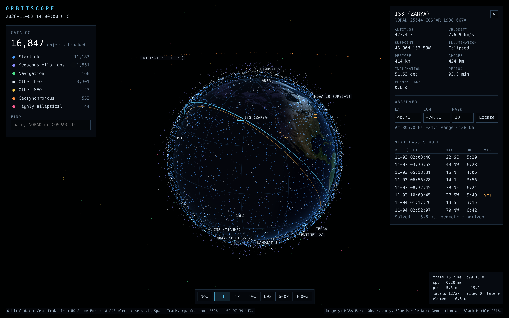
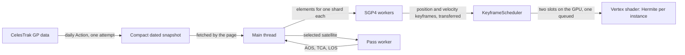
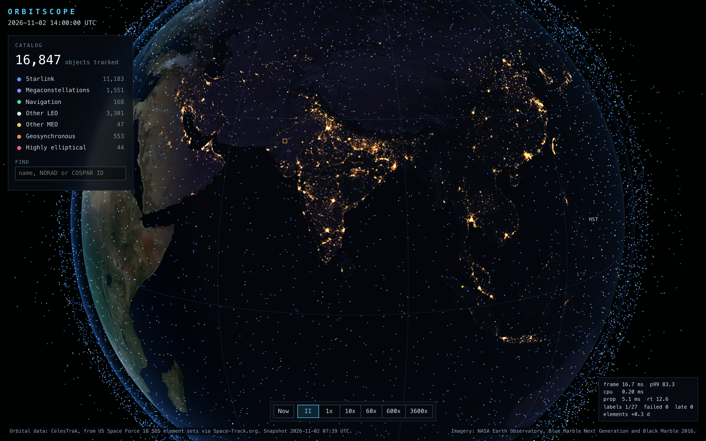
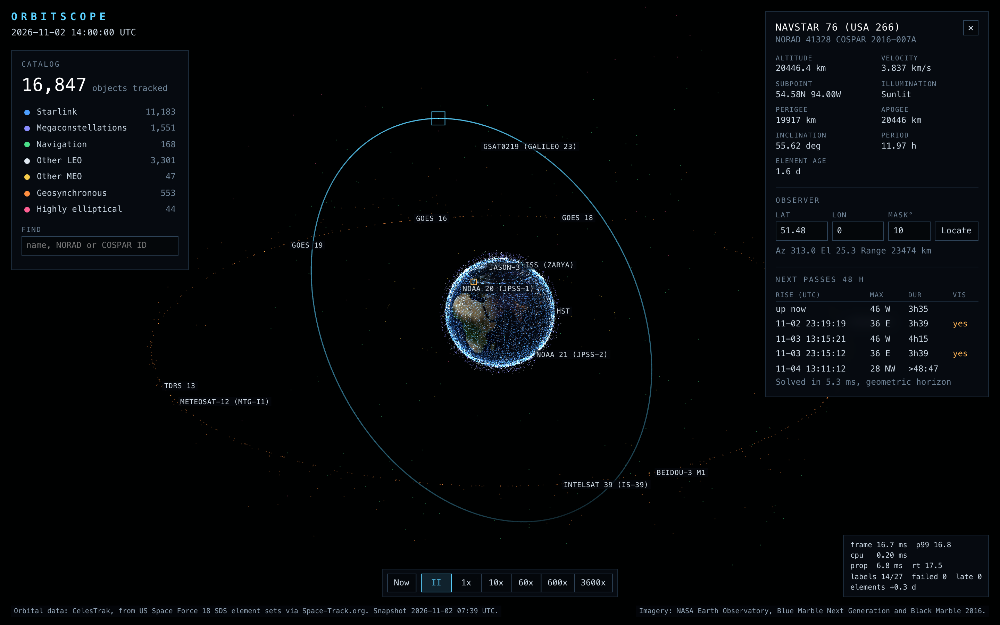
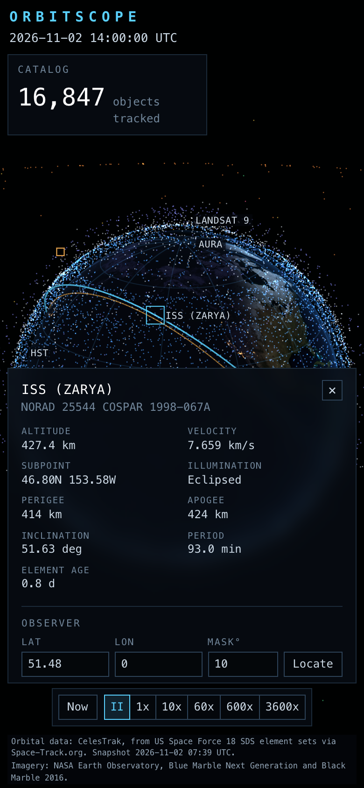

# orbitscope

Every active satellite on a WebGL globe, propagated in your browser by a hand-written SGP4. Click one to see its orbit, its live telemetry and its upcoming passes over your location.

**Live:** https://matejpopovski.github.io/orbitscope/

[](https://github.com/matejpopovski/orbitscope/actions/workflows/ci.yml)



| Measured on an Apple M3 Max, Chromium, 2880x1800 |                                                                |
| ------------------------------------------------ | -------------------------------------------------------------- |
| Satellites                                       | **16,847** real objects from a dated CelesTrak snapshot        |
| Frame interval                                   | **16.7 ms** median, 16.8 ms at p99, 0 of 719 frames over 20 ms |
| Frame cost                                       | about **0.1 ms** CPU and **0.6 ms** GPU (median)               |
| SGP4 against published vectors                   | **0.12 mm** worst case over 666 states                         |
| SGP4 against Vallado's compiled C++              | **0.039 mm** worst case over all 16,847 objects                |

## The problem

A browser has 16.7 ms per frame, shared with everything else the page and the browser are doing. SGP4 costs about 0.6 µs per call here, which sounds like nothing until it runs 16,847 times: propagating the catalog once takes about 10 ms on one thread. Doing that every frame on the main thread spends most of the budget before anything is drawn, and moving it to a worker only swaps a slow frame for a late one.

Three constraints outside the code shaped the design as much as that budget did.

- **TLEs no longer describe the catalog.** The 5-digit catalog numbers ran out in July 2026. 949 of the objects in this snapshot have 6-digit numbers that a two-line element set cannot express, 553 of them Starlinks. A pipeline built on TLE text cannot see them, so the site reads CCSDS OMM records and TLEs exist only to load the test vectors.
- **GitHub Pages cannot set response headers.** That rules out `SharedArrayBuffer`, which needs COOP and COEP, and with it the obvious way to share positions between workers and the renderer.
- **CelesTrak allows one download of a group per data update.** A repeat request gets a 403, and 50 errors within two hours puts the address on their firewall. Fetching from each visitor's browser is out of the question, and so is a retry loop in the refresh job.

## How a frame works

Per-frame CPU work does not depend on the number of satellites. The one exception is picking, a linear scan that runs only on frames where the pointer moved.

Workers do not compute positions for frames. They compute _keyframes_ of position and velocity, and the vertex shader evaluates a cubic Hermite polynomial between two keyframes for each satellite. One frame on the CPU is a uniform update and one instanced draw call, with a keyframe uploaded only when simulated time crosses one.



Keyframes are 5 s apart at real time and stretch with the time rate to a cap of 120 s. A third keyframe is always queued on the CPU, so crossing the upper one never waits for a worker. The scheduler keeps a single request in flight, recycles its buffers, tags requests with a generation so a result from before a time jump is discarded, and treats falling four intervals behind as a jump.

Positions reach the GPU as Float32 in Earth radii, the scene's own units. That resolves about 0.8 m in LEO and 3 m at GEO, which is far below a pixel.



### Choices that were rejected

| Rejected                                | Why                                                                                                                                                                                                                                                                                                                                                                                               |
| --------------------------------------- | ------------------------------------------------------------------------------------------------------------------------------------------------------------------------------------------------------------------------------------------------------------------------------------------------------------------------------------------------------------------------------------------------- |
| Propagate every frame in a worker       | Costs a full sweep 60 times a second to move dots by less than a pixel, and frames then wait on a message round trip.                                                                                                                                                                                                                                                                             |
| `SharedArrayBuffer`                     | Needs COOP and COEP headers, which GitHub Pages cannot send. Transferring each shard's buffer to its worker and back allocates nothing and costs one copy.                                                                                                                                                                                                                                        |
| Linear interpolation                    | At 120 s spacing its median error is 15 km. Hermite's is 5.7 m.                                                                                                                                                                                                                                                                                                                                   |
| GPU colour-ID picking                   | `readPixels` forces a synchronous GPU readback on every hover. A linear CPU scan with the same polynomial takes 0.2 ms.                                                                                                                                                                                                                                                                           |
| Per-object frustum culling on the CPU   | It would add exactly the per-frame CPU work this design removes, to save vertex work the GPU does trivially. The vertex shader rejects filtered, failed, Earth-occluded and off-screen objects by moving the quad outside clip space. Labels are the expensive per-object thing, so those are culled on the CPU: behind Earth, off screen, under a UI panel, then overlapping, in priority order. |
| `satellite.js` at runtime               | The point of the project. It is a dev dependency used as a cross-check, and a test fails if `src/` ever imports it.                                                                                                                                                                                                                                                                               |
| A framework                             | A few panels of text do not need one. `three` is the only runtime dependency.                                                                                                                                                                                                                                                                                                                     |
| Committing the snapshot to `main` daily | A roughly 2 MB file every day outgrows the repository in months. The refresh job force-pushes a single commit to an orphan `snapshot` branch, and the deploy overlays it.                                                                                                                                                                                                                         |

Filtering is a bitmask uniform, so toggling a category costs no upload at all. World space is TEME, so the only frame change per frame is rotating Earth by GMST, and the sphere mesh is generated with Z through the poles and X through Greenwich to make that rotation the whole transform.

## Checking the SGP4

The implementation is `src/sgp4/`, about 1,250 lines with no dependencies. Passing the published vectors was the starting point, and it turned out not to be enough on its own.

| Check              | Compared with                                                                  | Result                                                                                             | Source                                |
| ------------------ | ------------------------------------------------------------------------------ | -------------------------------------------------------------------------------------------------- | ------------------------------------- |
| Published vectors  | Vallado et al., 33 satellites (24 deep space), 666 state vectors               | Worst position 0.12 mm, worst velocity 0.85 µm/s, and the same seven error codes in the same order | `results/sgp4-vectors.json`           |
| Compiled reference | python-sgp4 2.27 (Vallado's C++), all 16,847 objects at 4 times, 67,384 states | Worst 0.039 mm, mean 0.09 µm, no disagreement about which states fail                              | `results/crosscheck-python-sgp4.json` |
| Independent port   | satellite.js 7.1.0, the same catalog plus 188 synthetic resonant orbits        | Worst 15 cm on the catalog, 0.9 µm on the synthetic set                                            | `results/crosscheck.json`             |
| Frame conversion   | Appendix C of the paper, TEME to ITRF with the published polar motion and UT1  | Under 0.5 m on each axis                                                                           | `tests/frames.test.ts`                |

32 of the 33 vector cases sit within 8.2 µm, which is what rounding to the published 8 decimal places allows on its own. Satellite 20413 is the exception at 0.12 mm, because its case runs to 1.8 million minutes from epoch and floating-point noise accumulates over that span.

The 15 cm against satellite.js looked like a bug here until the third implementation settled it. Those outliers are resonant objects, and satellite.js rounds OMM epochs to the millisecond through `Date`, which shifts their sidereal reference. This code matches the compiled C++ on the same objects to 0.04 mm.

One published line is not a vector. Satellite 33334 fails at epoch with code 3, and the reference still prints a state for it, because its output arrays hold whatever the previous satellite left there. A test confirms that line is identical to the previous satellite's last state, and expects the failure.

**What the vectors cannot see.** `scripts/mutation-check.ts` changes every numeric literal and arithmetic operator in turn, 1,760 mutants in all, and replays the vectors against each one. They catch 1,642 (93.3%). The survivors were the useful part:

- Nothing covered `minutesSinceEpoch`, the function that turns wall-clock time into SGP4 input, because the vector harness passes `tsince` straight in. Tests now go through absolute dates against satellite.js.
- The eccentricity polynomials of the one-day resonance were unconstrained, since the vector cases that reach them have almost no eccentricity. A second oracle of 5,244 reference states, including orbits placed either side of each eccentricity break, catches 11 more mutants, these among them.
- An argument that was always zero turned out to be dead code, and went.

Of the 107 left, I read each one: 57 change an initial value that is overwritten before use, 21 move a boundary by 0.1% where no test orbit lands, 13 are equivalent or only alter a return value no case reaches (flipping `xincp < 0` maps to the same orbit), 8 only affect how fast Kepler's equation converges, and 8 are off the replay path and tested directly. So a few branches remain unexercised by any reference, including the retrograde side of the near-equatorial guard, because no such orbit exists in the catalog or the vectors.

**SGP4's velocity is not the derivative of its position.** Interpolation error should fall as the fourth power of keyframe spacing, and instead it is linear up to 120 s. That is why:

| SGP4 velocity against a central difference of its position | Gap      |
| ---------------------------------------------------------- | -------- |
| Median object                                              | 1.1 cm/s |
| 99th percentile                                            | 6.2 cm/s |
| Worst object (MMS 2, eccentricity 0.82)                    | 6.6 m/s  |

Compiled C++ gives the same velocities, so this is a property of the theory and not an implementation error. It sets a floor under the interpolation error, and the floor is far below what can be seen: one pixel is about 28 km at the default zoom on a 900-pixel-tall window, and about 1 km at the closest zoom.

| Keyframe spacing | Median error | 99th percentile | Worst object | Linear interpolation, median |
| ---------------- | ------------ | --------------- | ------------ | ---------------------------- |
| 1 s              | 0.2 cm       | 1.0 cm          | 61.9 cm      | 1.1 m                        |
| 5 s              | 0.9 cm       | 4.8 cm          | 3.1 m        | 26.5 m                       |
| 15 s             | 2.6 cm       | 14.5 cm         | 9.3 m        | 238.5 m                      |
| 30 s             | 5.6 cm       | 29.3 cm         | 18.6 m       | 954.0 m                      |
| 60 s             | 35.9 cm      | 66.5 cm         | 37.1 m       | 3.8 km                       |
| 120 s            | 5.7 m        | 6.5 m           | 74.3 m       | 15.3 km                      |
| 240 s            | 91.5 m       | 102.9 m         | 222.0 m      | 61.0 km                      |
| 600 s            | 3.6 km       | 4.0 km          | 6.4 km       | 378.1 km                     |

Each object is checked at 12 phases of its orbit with `npx tsx scripts/report-accuracy.ts`. Only spacings up to 120 s are ever used.

The implementation is improved mode only, because that is what the vectors exercise. The authors' FAQ suggests AFSPC mode to match operational results, so `results/crosscheck.json` measures the cost: on this catalog the two modes differ by 0.7 mm on average and 9.8 m at worst.

## Frame times

Measured with `npx playwright test e2e/measure.spec.ts`: Playwright Chromium 1.49.1, headless, at 1440x900 and device scale 2, recording for 12 s after a 4 s settle. The GPU was the real thing, reported by the browser as `ANGLE (Apple, ANGLE Metal Renderer: Apple M3 Max, Unspecified Version)`. Results are in `results/frame-times.json`.

Three caveats apply to every number here. Headless Chromium paces `requestAnimationFrame` at 60 Hz, so frame interval cannot show headroom beyond that, and the CPU and GPU columns are what do. Chromium also coarsens `performance.now()` to 0.1 ms on a page that is not cross-origin isolated, so CPU values near 0.1 ms mean roughly that or less. And other jobs were running on this machine throughout, so numbers move a little between runs.

Scaling the catalog at 60x time rate, with four workers:

| Objects             | Frame median (ms) | Frame p99 (ms) | Frames over 20 ms | CPU median (ms) | GPU median (ms) | GPU p99 (ms) | Keyframe round trip (ms) |
| ------------------- | ----------------- | -------------- | ----------------- | --------------- | --------------- | ------------ | ------------------------ |
| 16,847              | 16.7              | 16.8           | 0                 | 0.1             | 0.609           | 1.331        | 1.9                      |
| 33,694 (synthetic)  | 16.7              | 16.8           | 0                 | 0.1             | 0.721           | 1.503        | 3.5                      |
| 67,388 (synthetic)  | 16.7              | 16.8           | 0                 | 0.2             | 0.993           | 2.184        | 6.8                      |
| 134,776 (synthetic) | 16.7              | 16.8           | 0                 | 0.2             | 1.698           | 3.693        | 13.6                     |
| 269,552 (synthetic) | 16.7              | 16.8           | 0                 | 0.2             | 2.521           | 5.652        | 27.5                     |
| 539,104 (synthetic) | 16.7              | 16.8           | 0                 | 0.1             | 4.231           | 7.181        | 51                       |

CPU time per frame stays at the timer's resolution from 16,847 to 539,104 objects, which is the design working. GPU time grows with count, as it must, and is 4.231 ms at the largest size. The test stopped at 32 copies without finding a limit, so where this breaks on this machine is unknown.

The real catalog across time rates:

| Time rate | Frame median (ms) | Frame p99 (ms) | Keyframe round trip (ms) | Late frames |
| --------- | ----------------- | -------------- | ------------------------ | ----------- |
| 1x        | 16.7              | 16.8           | 5.3                      | 0           |
| 60x       | 16.7              | 16.8           | 2.3                      | 0           |
| 600x      | 16.7              | 16.8           | 1.9                      | 0           |
| 3600x     | 16.7              | 16.8           | 2.4                      | 0           |

Time rate has no effect on the frame, only on how often keyframes are produced.

The worst case for propagation, 67,388 synthetic objects at 3600x, where a keyframe is due every 33.3 ms:

| Workers | Keyframe round trip (ms) | Late frames | Frame median (ms) |
| ------- | ------------------------ | ----------- | ----------------- |
| 1       | 26                       | 720 of 719  | 16.7              |
| 2       | 13.2                     | 0 of 719    | 16.7              |
| 4       | 7.2                      | 0 of 719    | 16.7              |
| 8       | 5.6                      | 0 of 719    | 16.7              |

One worker falls behind on every frame even though 26 ms fits inside 33.3 ms. Requests only go out on a frame boundary, so a job that takes longer than one frame costs two, which is 33.4 ms. The dots hold at the last keyframe for a moment while the frame rate stays at 60 fps, so rendering and propagation really are decoupled. Doubling the workers clears it.

**Software rendering is a different story.** The same page under SwiftShader (`ANGLE (Google, Vulkan 1.3.0 (SwiftShader Device (LLVM 10.0.0) (0x0000C0DE)), SwiftShader driver)`) ran at **1.4 fps**, 650 ms per frame, with 602 ms of that in the rasterizer. It competes for CPU with everything else on the machine, so this figure varies more than the others. It is not representative of a real GPU, and neither result says anything about hardware between the two. CI runs no frame measurements for this reason.

Single-threaded SGP4 under Node takes 0.58 µs per call, 9.7 ms for a sweep of the catalog (`results/propagation-node.json`). Initialising every object takes 61 ms.



## Pass prediction

A fixed time step misses a grazing pass shorter than the step, and a step short enough to catch one wastes most of its work. The sweep steps 30 s (120 s in deep space) but also treats any local maximum of elevation as a candidate and refines it with a golden-section search, even when no sample reached the mask. Rise and set are then bisected to 0.1 s. Tests compare the result with a one-second brute-force scan over 24 hours for ISS, Starlink, Iridium and GPS objects, with every pass found within 1.5 s, and a test constructs a pass of under 30 s and requires it to be found.

The Vis column marks a pass where the satellite is sunlit at closest approach while the sun is at least 6 degrees below the observer's horizon. That check is tested against satellite.js's independent sun position.

## Data and attribution

**Orbital data** comes from [CelesTrak](https://celestrak.org/), from general perturbations element sets published by the US Space Force 18th Space Defense Squadron via [Space-Track.org](https://www.space-track.org/). CelesTrak's [usage policy](https://celestrak.org/usage-policy.php) covers how to fetch data, not how to redistribute it. The closest thing to a redistribution permission is in the Space-Track documentation, where USSPACECOM gives blanket approval to transfer basic SSA data, which includes OMMs, on condition of appropriate citation. That approval is worded for data accessed through Space-Track, and this data reaches the project through CelesTrak, which states no redistribution terms of its own. The page, the snapshot file and this README all carry the citation. The same documentation states that the US Government does not warrant accuracy and that public element sets should not be used for conjunction assessment. Neither should this site.

The committed snapshot is `public/data/active-2026-11-02.json`: 16,847 objects in 2.3 MB, with element values passed through unrounded, since rounding an element changes the orbit. The saving comes from dropping JSON keys and the two fields SGP4 never reads.

`scripts/fetch-snapshot.mjs` is the only code that contacts CelesTrak, and a browser test asserts the running page requests nothing beyond its own origin. It makes one attempt with an identifying User-Agent, never follows a redirect, and exits non-zero on any non-200 response. A response that is short, not JSON or over 5 MB leaves the previous snapshot in place. All of that is tested against a local stand-in server that counts requests. The scheduled job may fail with a 403, because the limit is per user and GitHub-hosted runners share addresses. When it does, the site keeps serving the last good snapshot and the failed run is the report.

**Earth imagery** is unmodified NASA Earth Observatory data: Blue Marble Next Generation by Reto Stöckli (December 2004, 5400x2700) and Black Marble 2016 (3600x1800). NASA imagery is generally not subject to copyright in the US, and NASA asks to be credited as the source.

**The SGP4 implementation** follows D. A. Vallado, P. Crawford, R. Hujsak and T. S. Kelso, "Revisiting Spacetrack Report #3", AIAA 2006-6753, and the reference code [published with it](https://celestrak.org/publications/AIAA/2006-6753/). Variable names match the reference so the two can be read side by side. The authors' FAQ places no licence on that code and asks for citation in source and documentation, which is why it appears in both. `tests/fixtures/` holds their verification data (`SGP4-VER.TLE`, and `tcppver.out` as distributed with python-sgp4), which is reproduced for the tests and is not covered by this repository's MIT licence.

## Run it

Needs Node 20.19 or newer.

```sh
npm ci
npm run dev        # http://localhost:42160/orbitscope/
npm test           # 149 unit, vector and cross-check tests
npm run lint
npm run build
```

Everything quoted here comes from a file in `results/` and regenerates with one command:

```sh
npm run report                                # accuracy, mutation and Node throughput
npm run crosscheck:python                     # needs uv; compares with python-sgp4
npx playwright test e2e/app.spec.ts           # browser tests, needs Chromium
npx playwright test e2e/measure.spec.ts       # frame times, about 10 minutes
npx playwright test e2e/screenshots.spec.ts   # README images
```

Browser tests need `npx playwright install chromium` and run locally only: they exist to measure a GPU, which CI runners do not have.

The layout holds at phone width, with the panels collapsed and the attribution always visible.



Useful URL parameters: `?sat=25544` opens a satellite, `?t=2026-11-02T14:00:00Z` sets the time, `?rate=600` sets the time rate, and `?scale=8` multiplies the catalog for load testing, which the page labels as synthetic. Press `/` to search, Space to pause and Esc to deselect.

To refresh the snapshot by hand, run `npm run snapshot`. It does nothing if the snapshot is under 20 hours old, and CelesTrak will refuse a second download of the same data update in any case.

## Limitations

- **This verifies the implementation, not the truth.** Matching the reference proves the theory is computed correctly. It says nothing about where a satellite really is, which depends on the element set and how old it is. The oldest set in this snapshot is 27 days old, and the track panel shows each object's age.
- **Active satellites only.** The `active` group has no debris or rocket bodies, so this is a subset of what is tracked.
- **Frame times come from one high-end laptop.** There is no measurement on an integrated, older or mobile GPU, and the SwiftShader figure shows the page is unusable without hardware acceleration. The run was headless, so nothing was presented to a real display, and other jobs were sharing the machine. Hardware between those two points is unknown.
- **The deployment has not run.** The repository is not published yet, so the Pages and refresh workflows are checked by `actionlint` only. The snapshot fetcher is tested against a local server and ran once against CelesTrak, but not from a GitHub runner, where shared addresses make a 403 plausible.
- **Earth orientation is approximate.** UT1 is taken as UTC and polar motion is ignored, because both need a daily data feed. The test against the paper's worked example shows polar motion alone moves that vector by under 30 m. Up to 0.9 s of UT1 difference moves the ground by a few hundred metres.
- **Pass times are geometric.** There is no refraction or terrain, so real rises come slightly earlier and hills make them later. Only the sun's direction is modelled for visibility: the shadow is a cylinder, and Vis means sunlit against a dark sky, not bright enough to see. A GPS satellite can be marked `yes` and be far too faint.
- **The globe is a sphere.** Frames and observer positions use the WGS-84 ellipsoid, but the mesh does not, and the ground track is projected radially onto it. Mid-latitude subpoints are drawn up to about 0.2 degrees off the geodetic value, which the telemetry panel gets right.
- **Time runs forward at up to 3600x.** There is no scrubbing or reverse. Keyframe requests go out only on frame boundaries, so a keyframe that takes just over one frame takes two. If workers fall behind, dots hold at the last keyframe and the frame rate is unaffected.
- **Load-test objects are clones.** `?scale=N` phase-shifts real orbits, which is a fair test of rendering and propagation throughput but not of a real catalog of that size.
- **Needs WebGL 2 and module workers.** There is no fallback renderer. Dots cannot be reached by keyboard, though search can reach every object.
